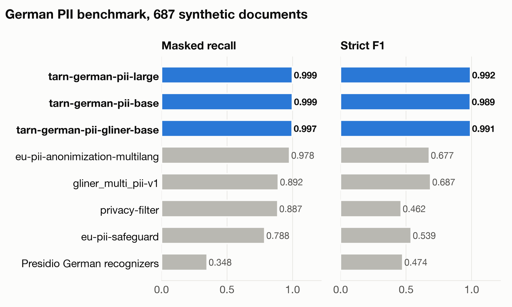

# Tarn: German PII detection

Open models that find personal data in German text, including German identifiers such as the tax ID, health insurance number, ID card, passport and driving licence numbers. Labels follow [Microsoft Presidio](https://github.com/microsoft/presidio), so Tarn drops into existing anonymization pipelines.

**[Try the demo](https://huggingface.co/spaces/syntriq/tarn-german-pii-demo)**: runs fully in your browser, no text leaves your device.

| Model | Parameters | Use |
|---|---|---|
| [syntriq/tarn-german-pii-base](https://huggingface.co/syntriq/tarn-german-pii-base) | 125M | Default, CPU and browser (ONNX int8) |
| [syntriq/tarn-german-pii-large](https://huggingface.co/syntriq/tarn-german-pii-large) | 335M | Highest strict F1 |
| [syntriq/tarn-german-pii-gliner-base](https://huggingface.co/syntriq/tarn-german-pii-gliner-base) | | Drop-in for Presidio's GLiNER recognizer |

Benchmark: [syntriq/german-pii-benchmark](https://huggingface.co/datasets/syntriq/german-pii-benchmark), 687 synthetic German documents, 8,035 labelled spans.

## Quickstart

```python
from transformers import pipeline

detector = pipeline("token-classification", model="syntriq/tarn-german-pii-base", aggregation_strategy="simple", stride=128)
detector("Frau Lena Schubert, Lindenallee 14, 04109 Leipzig, IBAN DE50 5260 1815 9083 0166 13, Steuer-ID 72659534808")
```

Keep `stride`: without it the pipeline stops after 512 tokens.

## Microsoft Presidio

```python
from presidio_analyzer import AnalyzerEngine
from presidio_analyzer.nlp_engine import NlpEngineProvider

engine = NlpEngineProvider(conf_file="presidio/german-pii.yaml").create_engine()
analyzer = AnalyzerEngine(nlp_engine=engine, supported_languages=["de"])
analyzer.analyze("Frau Lena Schubert, Steuer-ID 72659534808", language="de")
```

The config is in [`presidio/german-pii.yaml`](presidio/german-pii.yaml) and needs `python -m spacy download de_core_news_sm`.

## Labels

PERSON, EMAIL_ADDRESS, PHONE_NUMBER, ADDRESS, DATE_OF_BIRTH, IBAN_CODE, CREDIT_CARD, IP_ADDRESS, CUSTOMER_ID, DE_TAX_ID, DE_TAX_NUMBER, DE_SOCIAL_SECURITY, DE_HEALTH_INSURANCE, DE_ID_CARD, DE_PASSPORT, DE_FUEHRERSCHEIN, DE_KFZ, DE_LANR, DE_BSNR.

## Results



| Model | Masked recall | Masked precision | Strict F1 |
|---|---|---|---|
| **syntriq/tarn-german-pii-large** | 0.999 | 0.995 | 0.991 |
| **syntriq/tarn-german-pii-base** | 0.999 | 0.993 | 0.989 |
| **syntriq/tarn-german-pii-gliner-base** | 0.997 | 0.997 | 0.991 |
| bardsai/eu-pii-anonimization-multilang | 0.978 | 0.772 | 0.677 |
| urchade/gliner_multi_pii-v1 | 0.892 | 0.875 | 0.687 |
| openai/privacy-filter | 0.887 | 0.671 | 0.462 |
| tabularisai/eu-pii-safeguard | 0.788 | 0.892 | 0.539 |
| Presidio 2.2.366, German recognizers only | 0.348 | 0.970 | 0.474 |

All rows except Presidio come from `evaluate.py` in this repository.

Masked recall counts a personal value as found when any predicted span overlaps it. Strict F1 requires exact spans and labels, so it penalizes models that lack some of our labels. The benchmark is synthetic: document types, writer and name pool are unseen in training, but the identifier values come from the same generators as the training data. Real documents will score lower, so test on a sample of your own data.

## Reproduce

```bash
uv run evaluate.py --model syntriq/tarn-german-pii-base
uv run evaluate.py --model syntriq/tarn-german-pii-gliner-base --gliner
uv run evaluate.py --model bardsai/eu-pii-anonimization-multilang
```

`evaluate.py` downloads the benchmark from Hugging Face, runs the model and prints masked recall, masked precision and strict F1. Use `--output result.json` for per-label scores.

## Browser demo

[`demo/index.html`](demo/index.html) is the complete demo: one HTML file with transformers.js, served as a static Hugging Face Space. Open it from any static file server.

## Limitations

- Trained only on synthetic documents, no real personal data was used.
- Unusual layouts, heavy OCR noise or dialect can lower recall.
- Austrian and Swiss national identifiers are not covered.
- Detection is not anonymization in the legal sense. Combine it with human review where certainty is required.

## License

Apache-2.0. Built by [Syntriq](https://syntriq.de).
